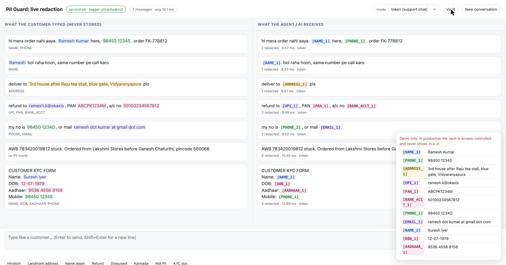

# PII Guard

India-first PII redaction for **customer chats and documents**: Aadhaar, PAN, GSTIN, UPI, Indian phone numbers, addresses with landmarks, Hinglish, and South Indian languages typed in English letters.

```
"hi mera order nahi aaya. Ramesh Kumar here, 98450 12345. upi refund to ramesh.k@okaxis pls"
                                      ↓  ~9 ms, CPU only
"hi mera order nahi aaya. [NAME_1] here, [PHONE_1]. upi refund to [UPI_1] pls"
```



## How it works
```
text ─► 1. Rules        regex + checksums (Verhoeff Aadhaar, Luhn card, GSTIN) + context words   (~0.1 ms)
     ─► 2. Tagger       fine-tuned DeBERTa-v3 token classifier, ONNX on CPU                       (~9 ms)
     ─► 3. Format checks relabel/drop implausible tagger output; whole words; follow "name is …"
     ─► 4. Memory       same person/number keeps the same token across a conversation
     ─► 5. Redact       token mode [NAME_1] (+ vault) or mask mode [NAME] (irreversible)
```
Rules win where they can verify (checksums); the model handles context (names, informal addresses, disguised numbers). The service **fails closed**: on any error it returns 503 and never echoes the input. Logs contain counts and timings, never text.

## Results
"Leak" = share of PII characters left readable after redaction (lower is better).

| Test set | Texts | Leak | Notes |
|---|---|---|---|
| [Ylemis India-PII benchmark](https://huggingface.co/datasets/Pranshurs/ylemis-india-pii-benchmark), Latin script | 5,945 | **0.6%** | independent, CC0 |
| Ylemis, native scripts (out of scope) | 4,055 | 0.4% | PII values mostly in Latin characters |
| [Maskara](https://huggingface.co/datasets/somukandula/maskara-indian-pii-200k) real-world eval | 2,600 | 2.1% | independent, MIT; many invalid synthetic IDs |
| Maskara template-disjoint eval | 10,457 | 4.6% | |
| Own hand-written set | 135 | 0.3% | optimistic (training data designed around its gaps) |

Compared on the hand-written set: rules + this tagger **0.3% @ 9 ms** · rules + Gemma-4 12B zero-shot 5.5% @ 3.5 s · rules + Gemma-4 E2B 7.5% @ 470 ms · rules + GLiNER-PII 14% @ 47 ms.

Load (one process, Apple M4 Pro): 30 msg/s steady → p95 19 ms, 0 errors; saturates around 70 msg/s.

Known weaknesses: false alarms on 20–33% of PII-free texts (tracking/order numbers, business names; errs toward over-masking); no labels yet for health IDs, account IDs, API keys/passwords; names written in Devanagari/Tamil script untested. Full write-ups: [`reports/M2_REPORT.md`](reports/M2_REPORT.md), [`reports/M3_REPORT.md`](reports/M3_REPORT.md).

## Model and licence
- **Code:** MIT (this repo).
- **Model weights are not in this repo.** The reference model was fine-tuned from [Piiranha](https://huggingface.co/iiiorg/piiranha-v1-detect-personal-information), which is **CC BY-NC-ND 4.0**, so it is kept in a **private** Hugging Face repo for personal, non-commercial use only.
- **To use PII Guard yourself, or commercially, train your own model** from the MIT-licensed `microsoft/deberta-v3-base` (or `mdeberta-v3-base` for multilingual):
  ```bash
  python -m pii.generate                                           # 15K synthetic examples, no real PII
  python -m pii.train --base microsoft/deberta-v3-base --out models/tagger-piiranha
  python -m pii.onnx_tagger export models/tagger-piiranha          # ONNX for serving
  ```

## Quick start (local demo)
```bash
python3.12 -m venv .venv && .venv/bin/pip install -r requirements-train.txt
python -m pii.generate && python -m pii.train --base microsoft/deberta-v3-base   # or put an existing model in models/tagger-piiranha
python -m pii.onnx_tagger export models/tagger-piiranha
.venv/bin/python -m pii.server                                  # http://localhost:5240 (demo mode)
```

## Docker
```bash
cp .env.example .env            # set PII_API_KEY; PII_MODEL_REPO + HF_TOKEN to download a private model
docker compose up --build       # http://localhost:5240/health
```
The image (~600 MB, no PyTorch) holds only code; the model is mounted at `/app/models/tagger` or downloaded at start-up from `PII_MODEL_REPO`. Defaults to `PII_MODE=prod` (no demo page, no vault endpoint).

| Env | Meaning |
|---|---|
| `PII_MODE` | `demo` (chat page + `/vault`) or `prod` |
| `PII_API_KEY` | if set, POST calls need `X-API-Key` |
| `PII_MODEL_DIR` / `PII_MODEL_REPO` / `HF_TOKEN` | where the model comes from |
| `PII_HOST` / `PII_PORT` | bind address (default `127.0.0.1:5240`, `0.0.0.0` in Docker) |

## API
```bash
curl -s localhost:5240/redact -H 'X-API-Key: …' \
  -d '{"text":"Ramesh 98450 12345","conversation_id":"chat-42","mode":"token"}'
# {"redacted":"[NAME_1] [PHONE_1]","entities":[{"label":"NAME","token":"[NAME_1]","start":0,"end":6,…}],"ms":9.4,…}
```
`POST /redact` · `POST /reset` · `GET /health` · `POST /vault` (demo mode only).

## Using it in your own chat app
With your own app you control the code, so the raw message never has to be stored or shown: **call PII Guard on your backend, in the message path, before anything is saved or delivered.**

```
customer app ──► your chat backend ──► PII Guard /redact ──► store REDACTED text ──► agent screen · bots · LLM · analytics
                         │                    └──► real values go to the vault (locked down)
                         └── if PII Guard fails → hold/queue the message, never pass it on raw (fail closed)
```

```python
r = requests.post("http://pii-guard:5240/redact", timeout=2,
                  headers={"X-API-Key": KEY},
                  json={"text": msg.text, "conversation_id": msg.chat_id, "mode": "token"})
r.raise_for_status()                      # error → don't save/forward; queue and retry
msg.text = r.json()["redacted"]           # "[NAME_1] here, [PHONE_1]"
save(msg); deliver_to_agent(msg)
```

1. **Server-side, not in the app**, so it can't be bypassed. An in-app preview ("this message contains an Aadhaar number") is a nice extra, not the safeguard.
2. **Pass the chat id as `conversation_id`**, so the same person keeps the same token (`[NAME_1]`) across the chat.
3. **Agents see tokens, not values.** When they need the real value (e.g. to call the customer), give them a button that asks your backend; the backend reads the vault (access-controlled, logged) and places the call. The agent never sees the number.
4. **`token` for chats, `mask` for logs and analytics.**
5. **Fail closed:** if PII Guard is down, hold the message rather than store it raw.
6. **Bots and LLMs get only the redacted text.** If a reply must contain a real value ("we'll call you on…"), swap the token back on your backend just before it goes to the customer.

Adds ~10–20 ms per message. Connectors for hosted platforms (Freshchat, Google Chat, …) are planned; until then, use the patterns below.

## Using it with someone else's chat app
Most teams use a hosted chat tool (Freshchat/Freshdesk, Zendesk, Intercom, a WhatsApp BSP such as Gupshup, Interakt or Twilio, Haptik, Yellow.ai…). You can't change that vendor's code, so PII Guard plugs in at the points you **do** control:

```
customer ──► chat vendor (sees the raw message) ──┬──► agents in the vendor's dashboard
                                                  │
                                                  └──► webhook ──► relay ──► PII Guard ──► redacted copy ──► your DB · analytics · LLM · CRM
                                                                                      └──► (optional) vendor "redact" API: clean the stored message
```

> **Be clear about what this does and doesn't do.** The vendor still receives and stores the raw message: it's your *data processor* under DPDP, so you need a processing agreement with them. PII Guard stops PII from spreading **beyond** the vendor (your databases, analytics, AI calls, exports), and can shrink what stays **inside** it. The only way to stop the vendor seeing PII at all is pattern D below.

| Pattern | Where it hooks in | What it protects | Effort |
|---|---|---|---|
| **A. Webhook relay** (start here) | Vendor's "new message" webhook → [`examples/webhook_relay.py`](examples/webhook_relay.py) → your systems | Everything you store or process downstream | Low |
| **B. Clean up inside the vendor** | Same webhook; after redacting, call the vendor's API to redact/edit the stored message, if it offers one (several helpdesks do; check yours) | The copy agents see later, exports, the vendor's own search | Medium; depends on the vendor's API |
| **C. Bot / AI middleware** | The vendor's bot calls your webhook or AI endpoint; redact before the LLM, then put real values back into the reply only where needed | Prompts sent to OpenAI/Claude/Gemini | Medium |
| **D. Your own website widget** | Your page/backend calls PII Guard before the message is sent to the vendor's API | The vendor never sees PII | Medium–high; agents see tokens, so actions like "call customer" go through your backend, which looks up the real value |
| **E. Archive clean-up** | Batch over the vendor's exports or data dumps | Historical data | Low |

**Pattern A in practice** (works with any vendor that sends webhooks):
1. Run PII Guard internally (`docker compose up`); set `PII_API_KEY`.
2. Run the relay next to it and tell it where the text and conversation id are in *your* vendor's payload:
   ```bash
   PII_API_KEY=… RELAY_SECRET=<vendor webhook secret> \
   RELAY_TEXT_FIELD=message.text RELAY_CONV_FIELD=conversation_id \
   RELAY_FORWARD_URL=https://your-internal-service/messages \
   python examples/webhook_relay.py          # listens on :5250/webhook
   ```
3. In the vendor's admin panel, point the **message webhook** at the relay (through your API gateway/ingress). Turn off or restrict any other integration that copies raw transcripts into your systems.
4. Your systems now receive e.g. `{"message":{"text":"hi, [NAME_1] here, [PHONE_1], refund to [UPI_1]"}, "pii":{"labels":["NAME","PHONE","UPI"]}}`. The same customer keeps the same token across a conversation, because the relay passes the vendor's conversation id.

**Rules the relay follows** (keep them if you write your own):
- **Verify the vendor's signature** (`RELAY_SECRET`, HMAC-SHA256 in `X-Signature`; adjust to your vendor's scheme), so nobody else can push messages in.
- **Fail closed:** if PII Guard is down, reply 503 and forward nothing. Vendors retry webhooks, so nothing is lost and nothing leaks.
- **Never log payloads.**
- **`mode`:** `token` where people may need the real value later (support follow-up, via a controlled vault lookup); `mask` for analytics and logs (irreversible).

## Evaluate
```bash
python -m tests.test_rules                                   # rule unit tests
python -m pii.tagger models/tagger-piiranha data/handwritten.jsonl data/test.jsonl
scripts/fetch_external.sh && python -m pii.external          # independent benchmarks
python -m pii.onnx_tagger bench models/tagger-piiranha data/handwritten.jsonl
python -m pii.loadtest                                       # against a running server
```

## Layout
```
pii/rules.py         checksums, regexes, context gates          pii/engine.py     detection + memory + redaction
pii/tagger.py        tagger runtime + format checks             pii/server.py     HTTP service (fail closed)
pii/onnx_tagger.py   ONNX export/serving/bench                  pii/static/       demo chat page
pii/generate.py      synthetic data (templates + fake values)   pii/fake.py       fake-but-valid Indian IDs
pii/train.py         fine-tuning                                pii/evaluate.py   recall/precision/leak
pii/external.py      public benchmark scoring                   pii/baselines.py  GLiNER/Piiranha; pii/gemma.py Gemma
data/handwritten.txt hand-written test set ([[LABEL:value]])    examples/webhook_relay.py  third-party chat app relay
PLAN.md · TASKS.md · STATUS.md  plan, task list, resume point
```

## DPDP note
PII Guard is a **security safeguard** (masking/tokenisation, as named in the DPDP Rules), not compliance by itself: consent, notices, rights requests and retention are separate obligations. Tokenised data is still personal data; only irreversible masking takes it out of scope. Not legal advice.
